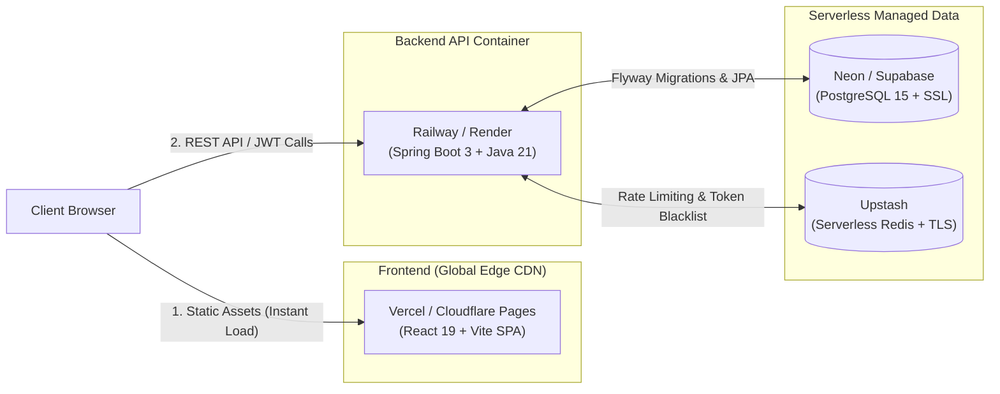

# Decoupled Cloud Architecture Deployment Guide

This guide provides step-by-step instructions for deploying the **Task Manager** application using **Alternative 4: Decoupled Cloud Architecture** (100% Free Tier capable).

---

## Architecture Overview



### Why Choose This Architecture?
- **Zero UI Cold Starts**: The React frontend is served globally via edge CDNs with zero latency.
- **Independent Scaling & Deployments**: UI changes deploy in seconds without restarting the backend.
- **Cost Efficiency**: Fits completely within the free tiers of Vercel, Neon, and Upstash.

---

## Pre-Configured Files in This Repository

| File | Purpose |
| :--- | :--- |
| [`frontend/vercel.json`](file:///home/jacc_shared/workspace/github/taskmanager-api/frontend/vercel.json) | Configures SPA rewrites on Vercel so routes like `/login` and `/dashboard` don't 404. |
| [`frontend/public/_redirects`](file:///home/jacc_shared/workspace/github/taskmanager-api/frontend/public/_redirects) | Provides SPA fallback routing for Cloudflare Pages and Netlify. |
| [`frontend/.env.example`](file:///home/jacc_shared/workspace/github/taskmanager-api/frontend/.env.example) | Documents the `VITE_API_BASE_URL` environment variable for production builds. |
| [`Dockerfile.api`](file:///home/jacc_shared/workspace/github/taskmanager-api/Dockerfile.api) | Standalone lightweight Dockerfile that builds only the Spring Boot backend without Node.js. |
| [`src/main/resources/application.properties`](file:///home/jacc_shared/workspace/github/taskmanager-api/src/main/resources/application.properties) | Configured to support cloud databases (Neon, Supabase), Redis TLS (Upstash), and dynamic CORS. |

---

## Step 1: Provision Serverless PostgreSQL (Neon or Supabase)

### Option A: Neon (Recommended — 30 seconds setup)
1. Sign up at [neon.tech](https://neon.tech/) (free tier: 0.5 GB storage, serverless compute).
2. Create a new project named `taskmanager`.
3. In the Neon Dashboard, locate your **Connection Details**:
   - Select **Connection string** > choose **Java (JDBC)** or **Postgres**.
   - Note the Host (e.g. `ep-cool-pool-123456.us-east-2.aws.neon.tech`), Database (`neondb`), User, and Password.
4. Your JDBC URL format will be:
   ```text
   jdbc:postgresql://<HOST>:5432/<DB>?sslmode=require
   ```

### Option B: Supabase
1. Create a project at [supabase.com](https://supabase.com/).
2. Under **Project Settings** > **Database** > **Connection string**, copy the JDBC URI with `?sslmode=require`.

---

## Step 2: Provision Serverless Redis (Upstash)

1. Sign up at [upstash.com](https://upstash.com/) (free tier: 10,000 commands/day).
2. Click **Create Database**:
   - Name: `taskmanager-redis`
   - Type: **Regional** (choose the same region as your database/backend).
   - Enable **TLS/SSL**.
3. Under the **Details** tab, locate:
   - **Endpoint** (Host): e.g. `us1-proud-cat-12345.upstash.io`
   - **Port**: `6379`
   - **Password**: `<YOUR_UPSTASH_PASSWORD>`

---

## Step 3: Deploy Backend API (Railway or Render)

### Deploying to Railway (Recommended)
1. Sign in to [railway.app](https://railway.app/) and click **New Project** > **Deploy from GitHub repo**.
2. Select the `taskmanager-api` repository.
3. In the service **Settings**:
   - Set **Dockerfile Path** to: `Dockerfile.api` (or leave default `Dockerfile`).
4. In the **Variables** tab, add the following environment variables:

```dotenv
# Port
SERVER_PORT=8080

# PostgreSQL (from Neon / Supabase)
POSTGRES_HOST=ep-cool-pool-123456.us-east-2.aws.neon.tech
POSTGRES_PORT=5432
POSTGRES_DB=neondb
POSTGRES_USER=neondb_owner
POSTGRES_PASSWORD=your_neon_password
POSTGRES_PARAMS=?sslmode=require

# Redis (from Upstash)
REDIS_HOST=us1-proud-cat-12345.upstash.io
REDIS_PORT=6379
REDIS_PASSWORD=your_upstash_password
REDIS_SSL=true

# CORS: Allow your frontend domain (you will update this in Step 4)
CORS_ALLOWED_ORIGINS=https://localhost:5173,https://your-frontend.vercel.app

# JWT Secrets (Customize for production)
APP_JWT_ACCESS_EXPIRATION=3600000
APP_JWT_REFRESH_EXPIRATION=604800000
```

*(Alternatively, you can provide `SPRING_DATASOURCE_URL=jdbc:postgresql://<HOST>:5432/<DB>?sslmode=require` instead of individual Postgres properties).*

5. In **Settings** > **Networking**, click **Generate Domain** (e.g. `https://taskmanager-api-production.up.railway.app`).
6. Test your backend by visiting `https://<YOUR_BACKEND_DOMAIN>/api/v1/auth/login` (it should return 405 Method Not Allowed or 401 Unauthorized, confirming the Spring Boot API is online).

---

## Step 4: Deploy Frontend (Vercel or Cloudflare Pages)

### Deploying to Vercel (Recommended)
1. Sign in to [vercel.com](https://vercel.com/) and click **Add New...** > **Project**.
2. Import your `taskmanager-api` GitHub repository.
3. In the project setup screen:
   - **Framework Preset**: `Vite`
   - **Root Directory**: Click *Edit* and select **`frontend`**.
   - **Build Command**: `npm run build` (auto-detected)
   - **Output Directory**: `dist` (auto-detected)
4. Expand **Environment Variables** and add:
   - **Name**: `VITE_API_BASE_URL`
   - **Value**: `https://<YOUR_BACKEND_DOMAIN>` (e.g. `https://taskmanager-api-production.up.railway.app`)
     *(Do not add a trailing slash)*
5. Click **Deploy**.
6. Once deployed, Vercel provides a public HTTPS URL (e.g. `https://taskmanager-app.vercel.app`).

### Update Backend CORS
Return to your Railway/Render dashboard and add your Vercel URL to `CORS_ALLOWED_ORIGINS`:
```dotenv
CORS_ALLOWED_ORIGINS=https://taskmanager-app.vercel.app
```
Railway will automatically redeploy with the updated CORS rule.

---

## Step 5: Verification & Testing Checklist

1. Open your Vercel deployment URL (`https://your-app.vercel.app`).
2. Verify that the bottom right indicator displays:
   `API: https://taskmanager-api-production.up.railway.app`
3. Click **"Auto-fill Demo Account"** on the login screen.
4. Sign in with the seeded demo credentials:
   - **Email**: `demo@example.com`
   - **Password**: `Password123!`
5. Verify that:
   - The 3 pre-seeded demo projects load immediately.
   - Tasks display with tags, priorities, and assignees.
   - You can create, move, and edit tasks.
   - Rate limiting and token refresh work smoothly via Upstash.

---

## Troubleshooting Decoupled Cloud Deployments

- **CORS Error in Browser Console (`Access to fetch ... has been blocked by CORS policy`)**:
  Ensure `CORS_ALLOWED_ORIGINS` on your backend matches your frontend URL exactly (including `https://` without a trailing slash). If left blank, the backend allows all origin patterns by default.
- **Neon / Supabase Connection Refused or SSL Error**:
  Ensure `POSTGRES_PARAMS=?sslmode=require` is appended to the connection string, as Neon and Supabase reject non-SSL connections.
- **Upstash Redis Connection Reset**:
  Confirm `REDIS_SSL=true` and verify the password from the Upstash console.
- **Page Refresh Returns 404 on Vercel**:
  Ensure [`frontend/vercel.json`](file:///home/jacc_shared/workspace/github/taskmanager-api/frontend/vercel.json) is committed to your repository so Vercel rewrites client-side paths to `/index.html`.
